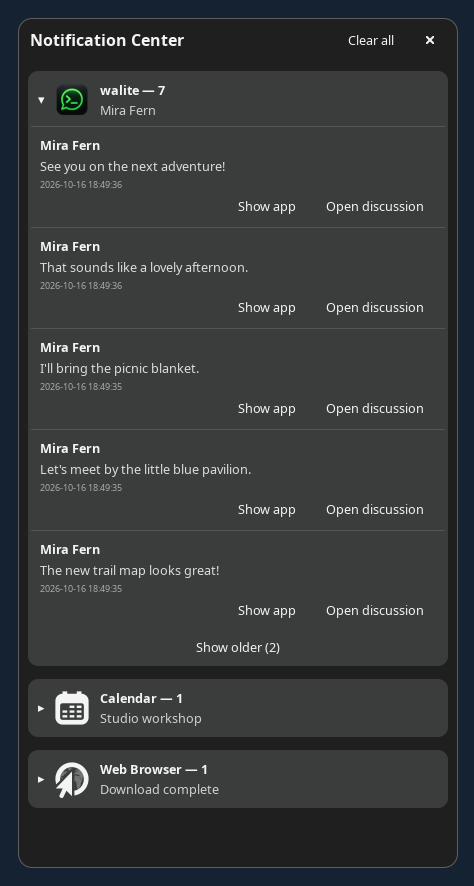
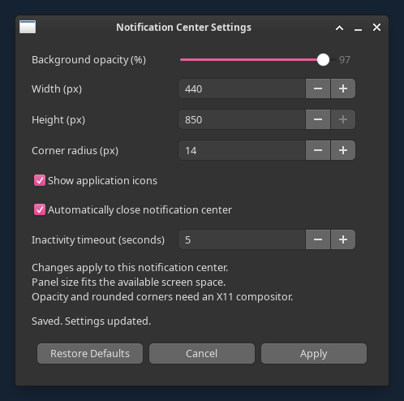
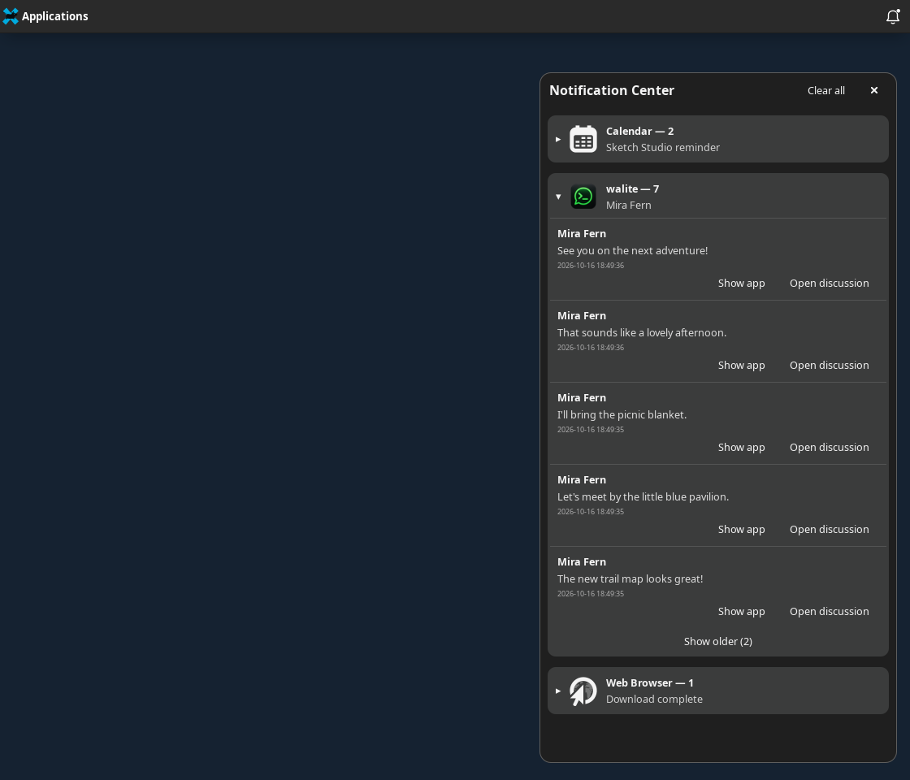

# dunst_tray

A lightweight system-tray bell and persistent notification center for **Dunst
on Linux/X11**.

Keep Dunst's popups and add a place to review notifications later. `dunst_tray`
passively observes notification calls, stores a bounded local history, and
groups messages by application. Dunst remains the sole notification daemon.

Built with Python, GTK3, and SQLite, with event-driven updates and no polling
loop, web server, or browser runtime.

**Status:** pre-release (`0.1.0.dev0`). Verified on MX Linux / Debian Trixie with
Xfce, X11, and Dunst 1.12.2. i3 support is intended but not yet verified.

## Screenshots

Real GTK3/X11 captures in an isolated Xfce session, using only fictional contacts
and example notifications. Click an image for its full-resolution view.

**Notification Center and Settings**

<p>
  <a href="docs/screenshots/notification-center.png"></a>
  <a href="docs/screenshots/settings.png"></a>
</p>

**Xfce desktop integration** — the bell's white dot marks a new notification
that arrived after opening the center.

[](docs/screenshots/desktop-integration.png)

No personal history, account data or desktop content was loaded. See the
[capture and privacy record](docs/screenshots/README.md).

## Features

- Persistent tray bell with **one white dot** when retained notifications are
  unread. No badge count or exclamation mark.
- Notification history and unread state survive application restarts.
- A notification center with per-application groups, expand/collapse, scrolling,
  and incremental access to older messages.
- Independent retention of notification calls, including messages that Dunst
  replaces or combines into a single popup. Default retention: 100 messages.
- Do Not Disturb controls, replay through Dunst, and confirmed history clearing.
- **Show app** is offered independently of sender callbacks and focuses a
  verified, unique running window, including reliably identified terminal apps.
- **Open discussion** uses compatible Walite notifications' private one-time
  tickets to request the original direct/group chat, independently of Show app.
  V2 rotates tickets securely so the same notification can be opened repeatedly.
- Application icons from notification data, icon themes, or installed desktop
  entries, with a fallback when an icon is unavailable.
- Graphical appearance settings for background opacity, width, height, corner
  radius, and application-icon visibility.
- Optional inactivity auto-hide, disabled by default, with a 3–120 second
  timeout (5 seconds initially). Hides only the center, not the tray or history.
- **Apply**, **Cancel**, and **Restore Defaults**, with saved preferences and
  immediate appearance updates.

## Requirements

- Linux with **X11**, Python **3.11+**, GTK3, PyGObject, and Pycairo.
- A running **Dunst** instance, including its `dunstctl` command.
- `wmctrl` and `xprop` for verified application-window focusing.
- A session D-Bus that permits same-user notification monitoring through
  `org.freedesktop.DBus.Monitoring.BecomeMonitor`.
- An **XEmbed system tray**, such as Xfce's Notification Area. i3 needs an
  XEmbed-capable tray configuration; its integration remains unverified.
- An X11 compositor for translucent backgrounds and rounded clipping. Without
  one, the center uses an opaque rectangular surface.

SQLite is provided by Python's standard library. Wayland is not supported.

## Installation

Install system dependencies on Debian / MX Linux:

```sh
sudo apt install git dunst python3 python3-gi python3-cairo \
  python3-gi-cairo gir1.2-gtk-3.0 wmctrl x11-utils
```

Clone and install as your normal user:

```sh
git clone https://github.com/antoinebaudrimont-beep/dunst_tray.git
cd dunst_tray
./scripts/install.sh
~/.local/bin/dunst-tray
```

The installer needs no root privileges. It installs the application and creates
a desktop autostart entry for the current user. It preserves existing config
and history and does not edit, start, stop, or replace Dunst. Keep your existing
Dunst session setup running.

| Default location | Purpose |
| --- | --- |
| `~/.local/opt/dunst-tray/` | Application files |
| `~/.local/bin/dunst-tray` | Launcher |
| `~/.config/dunst-tray/config.ini` | Preferences |
| `~/.local/share/dunst-tray/history.sqlite3` | Private notification history |
| `~/.config/autostart/dunst-tray.desktop` | Desktop autostart entry |

Config, data, and autostart paths honor `XDG_CONFIG_HOME` / `XDG_DATA_HOME` when
set. The launcher and application directory stay under `~/.local`.

Autostart is configured by installation. The user verified Xfce startup after
reboot on 2026-10-15; this is user-reported, not a fresh agent-run reboot test.
A single-instance lock prevents duplicate
tray processes. To update, quit the running tray, pull changes, rerun the
installer, and start the launcher again.

## Usage

- **Left-click the bell:** open or close the notification center.
- **Right-click the bell:** open controls for notifications, replay, history,
  Settings, and quitting the tray application.
- **Notifications enabled:** uncheck to enable DND; check to resume Dunst.
  Notifications captured during DND still count as unread.
- **Application group header:** expand or collapse its messages. Messages are
  newest first; **Show older** reveals more without deleting retained text.
- **Show app:** raise the running application's window. This does not open a
  particular message or start another application process.
- **Open discussion (Walite):** request that notification's original chat in
  the already-running producer. V2 supports repeated clicks with fresh one-use
  tickets, bounded to 32 notification chains and 24 hours per Walite instance.
  Old history cannot navigate after Walite restarts. Busy Walite protects drafts
  and dialogs. See the [integration and limitations](docs/WALITE.md).
- **Clear notification history:** after confirmation, clear the companion's
  retained history and Dunst's history. This resets unread state.

### Unread behavior

Opening the center acknowledges all currently retained messages and removes
the dot. Messages arriving while the center is open remain unread until the
next explicit opening. Closing alone does not acknowledge them. Unread state
persists across tray restarts and is independent of DND and total history size.
Existing history from before the unread feature migrates as read.

### Appearance and behavior settings

Open **Settings** from the tray menu:

| Setting | Range |
| --- | --- |
| Background opacity | 50–100% |
| Width | 280–550 px |
| Height | 300–850 px |
| Corner radius | 0–24 px |
| Show application icons | On / off; disabling reclaims icon spacing |
| Automatically close notification center | Off by default |
| Inactivity timeout | 3–120 seconds; initially 5 |

The panel fits the monitor's usable work area. Opacity affects the background
while text stays readable. These controls affect the notification center, not
Dunst's popups.

**Apply** saves and repaints immediately. **Cancel** discards unsaved edits;
changes already applied remain saved. **Restore Defaults** fills the controls
and takes effect only after Apply. Appearance changes do not clear history or
require a Dunst restart.

Auto-hide starts when the center opens and resets on mouse motion, scrolling,
keys and touch. Held pointer controls, Settings, menus, confirmation/error
dialogs and application-action transactions pause it. After interaction ends,
a full timeout starts again. Auto-hide does not clear history, acknowledge new
arrivals, change DND or stop the bell. Existing configuration files remain
manual-close until you explicitly enable it and Apply.

### Configuration file

Default preferences:

```ini
[history]
limit = 100
page_size = 5

[panel]
width = 380
height = 680
opacity = 97
corner_radius = 14
show_icons = true
auto_hide = false
auto_hide_timeout = 5
margin_top = 48
margin_right = 16

[capture]
monitor_dbus = true
```

Restart the tray after manual file edits. The Settings dialog saves its
options atomically while preserving unrelated settings.

## Compatibility and limitations

Verified desktop behavior includes notification capture, Xfce tray interaction,
DND, history/unread persistence, appearance persistence, and window focusing
for aerc, ChatGPT, Walite, Task Manager, and synthetic GTK/terminal fixtures.
Details and actual evidence are in the
[validation record](docs/VALIDATION.md).

- **Show app is application focus, not message navigation.** It appears for
  every notification and is enabled only for a reliable
  single running window. Missing, unknown, or ambiguous targets are disabled
  with an explanatory tooltip. No window is selected using partial title text.
  Desktop metadata, exact X11 class identities and conservative foreground-PTY
  ownership checks are detailed in [application actions](docs/ACTIONS.md).
- Dunst's original actions are tied to popup position and sender lifetime;
  saved callbacks cannot safely select a particular historical message. New
  Walite notifications use a separate documented one-time ticket protocol;
  older records retain application focus through the existing X11 marker.
- D-Bus policy restrictions can prevent passive capture while leaving tray
  controls usable. The tray never takes ownership of the notification service.
- Popups, popup stacking, screen position, and visible-popup limits remain
  Dunst's responsibility. A reference configuration fragment is provided in
  [docs/dunst-integration.conf](docs/dunst-integration.conf).
- aerc's current mail hook has no per-message callback or target metadata.
  Its existing window can be focused, but **Open message is unavailable**.
  Command IPC is not itself a safe notification-to-email binding; see
  [aerc investigation](docs/ACTIONS.md#aerc).
- Agent-run reboot/login behavior and i3 integration remain unverified.
  App focusing was checked with synthetic notifications, not private messages.
- Actual light-panel configuration, compositor-off operation, monitor hotplug,
  session-bus disconnection, and long-duration resource use remain unverified.

## Testing

The generic-actions/auto-hide and screenshot checks on **2026-10-16** run **76 tests**,
including opt-in GTK/X11 tests and native Unix sockets.

Run pure tests without a desktop session:

```sh
PYTHONPATH=src python3 -m unittest discover -s tests -v
```

Without a desktop, GTK checks are skipped. Run the complete suite on an X11
desktop with the system GTK/Python dependencies installed:

```sh
DUNST_TRAY_GUI_TESTS=1 PYTHONPATH=src python3 -m unittest discover -s tests -v
python3 -m compileall -q src tests
sh -n scripts/install.sh scripts/uninstall.sh
```

`desktop-file-validate assets/dunst-tray.desktop` is an additional check when
`desktop-file-utils` is installed.

Automated tests are separate from the recorded **live Xfce acceptance** of real
capture, tray clicks, DND, 20-message unread behavior, settings, restarts, and
application focus. Dates and scope are recorded explicitly in the validation
record; synthetic checks do not establish private-message navigation support.

[`scripts/check_live.py`](scripts/check_live.py) contains the opt-in live
sequence. Read its header before running: it briefly changes/restores DND and
requires stopping the normal tray to keep fixtures out of normal history. It
uses temporary synthetic history, filters personal notifications, and disables
daemon-history deletion. Restart the normal tray afterward.

[`scripts/check_actions_autohide_live.py`](scripts/check_actions_autohide_live.py)
adds no-callback application focusing, terminal ambiguity, physical inactivity
events, Settings holds and preference restarts. Stop the normal tray first;
its temporary history accepts only synthetic notifications and it never changes
DND. `xdotool` and `kitty` are opt-in acceptance tools, not new runtime needs.

## Privacy

Notification contents stay in the local SQLite store. Its directory is mode
`0700` and the database is mode `0600`. Display fields, action identifiers,
desktop identity, and read state are retained; arbitrary hints and sender PIDs
are not. The known Walite activation hint is retained privately with its record
until consumption/rotation, expiry rejection, retention or clearing. A v2
successor replaces it in that same record; neither contains a stable ChatID.
Do not attach private history or real message screenshots to issues.

## Uninstall

Quit the tray and remove the application and autostart entry while keeping
preferences and history:

```sh
./scripts/uninstall.sh
```

To also permanently remove preferences and notification history:

```sh
./scripts/uninstall.sh --purge
```

Dunst is not removed or reconfigured.

## Development

See the [architecture](docs/ARCHITECTURE.md),
[work checkpoint](docs/WORK_PROGRESS.md), and
[publishing notes](docs/PUBLISHING.md). Use synthetic fixtures and screenshots,
run relevant tests, and keep changes focused.

## License

[MIT](LICENSE). The existing license is preserved.
